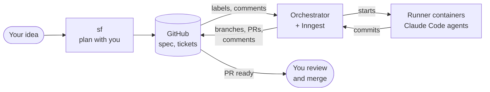
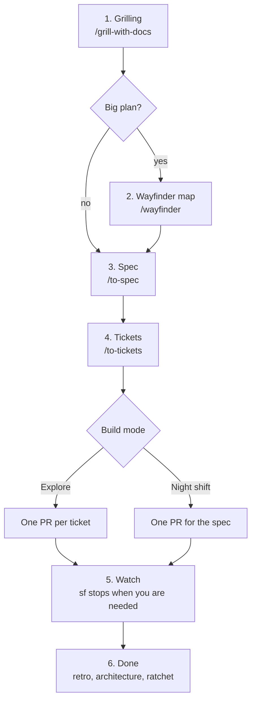
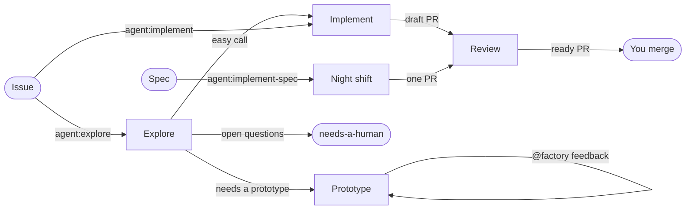
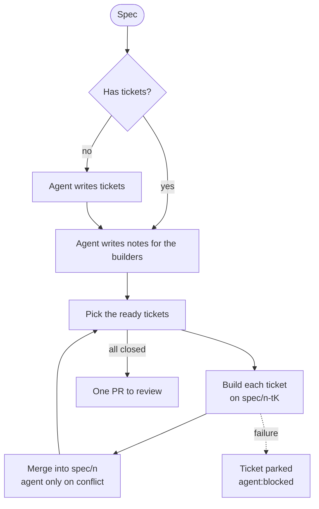
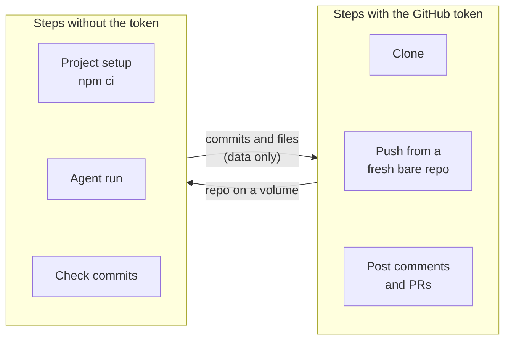

# sf-kit: a self-hosted software factory

sf-kit turns GitHub issues into pull requests. Agents do the work in Docker containers on your own machine. You make the decisions. The factory does the typing.

You start from an idea. The `sf` command plans it with you, writes a spec and tickets, and hands the tickets to the factory. Then it shows the agents at work and stops when something needs you.



## What is in this folder

| Path | What it does |
| --- | --- |
| `sf` (`cli/sf.mjs`) | The pipeline CLI. It takes an idea from planning to merged pull requests. It shows the factory's Inngest runs and what each running agent does. |
| `herdr-plugin/` | An optional [herdr](https://herdr.dev) plugin. It lets you pick a running agent and follow it in a herdr pane. |
| `init-host.sh` | Prepares a VPS or laptop once. It installs Inngest, Postgres, Redis, optional Phoenix, the run network, firewall rules, the runner image and the template unit for the factories. It writes the shared env file and starts no factory. It never overwrites secrets. |
| `setup-wizard.sh` | Run it after `init-host.sh`, once for each repo. Each run adds or edits one factory. It asks for the repo, the factory name, the GitHub token, the port, the firewall rule, the start, and webhook or polling. The first run also asks for the Claude token and optional Langfuse keys. It checks each value. |
| `init-project.sh` | Makes a project ready for the factory. It adds the agent guide files, the tracker doc, the skills and the agent scripts. It never overwrites a file. |
| `orchestrator/` | The Node app. It turns GitHub events into Inngest events. Its functions run the agent tasks in Docker. |
| `host/` | The compose file, the runner Dockerfile, the Caddyfile and the systemd template unit `factory-orchestrator@.service`. `init-host.sh` installs them. |
| `project-template/` | The files `init-project.sh` copies: `AGENTS.md`, `GLOSSARY.md`, `CODING_STANDARDS.md`, the tracker doc, the PR template, the pre-commit hook (`.githooks/pre-commit`, with `scripts/check-file-tokens.mjs`) and a CI workflow (`.github/workflows/check.yml`). `npm install` turns the hook on, in your clone and in each agent's clone. The hook runs `npm run check:fast` when the project has it, else `npm run check`. CI runs the full check. Keep `check:fast` to a few seconds, because agents commit often. |

## Install

```bash
# The host, once per machine. The dry run shows each change first.
./init-host.sh --observability phoenix --dry-run
./init-host.sh --observability phoenix
./setup-wizard.sh                  # once per repo: one factory each

ln -s "$PWD/sf" ~/.local/bin/sf

# A new project: the base, the agent files, a first commit and a private GitHub repo.
cd ~/code && sf new my-app "<what you want to build>"

# Or an existing project. Add --dry-run first to see what changes.
./init-project.sh --path ~/code/my-app --labels
(cd ~/code/my-app && npm i -D @ai-hero/sandcastle@^0.14 tsx zod@^3.25)
cd ~/code/my-app && sf idea "<what you want to build>"
```

Each init script prints its next steps at the end.

`sf new` makes a React Router, TypeScript and Vitest app, the stack the agent prompts expect. It adds the agent files and the scripts the agents run: `npm run check` (types, then tests) and `npm run build`. It runs both and makes the first commit. Then it asks before it creates the private GitHub repo and the factory labels. At the end, it prints the `setup-wizard.sh --repo` command that adds a factory for the new repo.

## One factory per repo

One factory host runs one factory for each repo. All factories share one Inngest server, one runner image, one run network and one slot cap. Each factory has its own name, Inngest app, event names, port, env file, GitHub token and systemd unit.

| Item | Where |
| --- | --- |
| Factory name | Lowercase letters, digits and dashes, starting with a letter, 21 characters at most. The wizard proposes one from the repo name. |
| Shared env file | `/etc/factory/common.env`: the Inngest settings and keys, `CLAUDE_CODE_OAUTH_TOKEN`, `FACTORY_SLOTS` and the trace settings |
| Factory env file | `/etc/factory/factories/<name>.env`: `GITHUB_REPO`, `FACTORY_PAT`, `PORT`, `GITHUB_WEBHOOK_SECRET`, `GITHUB_POLL` and the other values of one repo. A value here wins over the shared file. |
| systemd unit | `factory-orchestrator@<name>.service`. The unit sets the factory name, so no env file can change it. |
| Inngest app | `software-factory-<name>` |
| Event names | `factory/<name>/<event>`, for example `factory/qf/ratchet.requested` |
| Port | The wizard picks the highest saved port plus 1, from 3000. The firewall lets Inngest reach ports 3000 to 3099. |

`sf` finds the factory whose `GITHUB_REPO` matches the git origin of the folder. If no factory serves the repo, `sf` offers to run the wizard. Set `ENV_DIR` to read the env files from a folder other than `/etc/factory`. Set `SF_ORCHESTRATOR_URL` and `SF_FACTORY` to use a factory on another machine.

After an update of the orchestrator code, restart every factory: `sudo systemctl restart 'factory-orchestrator@*'`.

## The `sf` pipeline

`sf` suggests each step and runs it only when you say yes. Run `sf` again at any time to continue where you stopped.



| Step | Who works | What happens |
| --- | --- | --- |
| 1. Grilling | You and Claude | `/grill-with-docs` asks you questions until the plan is clear. It writes `GLOSSARY.md` and ADRs. It tells you if the plan needs a Wayfinder map. You decide. |
| 2. Wayfinder (optional) | You and Claude | `/wayfinder` makes a map of decision tickets. `sf` opens a fresh session for each ready ticket until the map is clear. |
| 3. Spec | You and Claude | `/to-spec` publishes the spec issue with the label `spec`. |
| 4. Tickets | You and Claude | `/to-tickets` publishes sub-issues of the spec with blocking edges. You approve the split. |
| 5. Build | The factory | First `sf` checks that `GLOSSARY.md`, `CODING_STANDARDS.md` and `docs/` are committed and on GitHub. The agents clone from there. `sf` pulls before it pushes, and it stops on a conflict. Then explore mode labels each ready ticket `agent:explore`, and each ticket gets its own PR. Night shift mode labels the spec `agent:implement-spec`, and you get one PR. |
| 6. Done | You and Claude | `sf` offers to close the spec. It suggests `/retro`, an architecture review and a lint ratchet run. Each one asks first. |

The docs change with the code. Each ticket the agents get ends with its parent spec, so the spec's decisions reach the implementer and the reviewer. The implementer adds a new domain term to `GLOSSARY.md` in its PR. The reviewer adds each judgement rule it wanted to `CODING_STANDARDS.md` on the PR branch. You approve both when you merge.

`sf` also shows open issues from outside its spec that carry a factory label. When no idea is in progress, run `sf` to see only these issues. `ready-for-agent` marks an issue as ready, but it starts no run. `sf` offers each such issue to the factory and adds `agent:explore` when you say yes. Explore follows the rule in [Security](#security). It takes the label off an issue that fails it and says why in a comment.

While the factory builds, `sf` shows each ticket's status, the factory's runs and the agents' actions. See [What the board shows](#what-the-board-shows). It stops when:

- a PR is ready to merge
- a ticket needs your decision
- a prototype is ready to see
- a run failed

Add `--recommended` (or `-r`) to `sf idea` or `sf new` to answer fewer questions. The grilling then takes its own recommended answer for each question. It asks you only for facts it cannot know and for hard-to-reverse choices with no clear answer. At the end, it lists each decision it made, so you can overrule any of them. `sf` also takes the session's Wayfinder suggestion.

Other commands: `sf new`, `sf status`, `sf watch`, `sf logs <text>`, `sf retro`, `sf architecture`, `sf ratchet` and `sf rebase`.

- **Planning sessions are interactive.** Type `/exit` in Claude to go back to `sf`. Each session writes a small result file in `.sf/`, for example the spec number. If the file is missing, `sf` asks you.
- **GitHub holds the state.** `.sf/state.json` holds only the Claude session id and the spec and map numbers. Git ignores it.
- **`sf` never merges on its own.** A merge needs two yes answers. The default answer at every stop is "skip".
- **`sf` needs a terminal.** Without one, it reads one answer per line from stdin and stops when the answers run out. It never answers for you.
- **The agent view needs Docker access.** `sf` reads the agent containers on the same machine. It shows only the agents of its repo. On another machine, use the Inngest dashboard.

### What the board shows

`sf status` prints the board once. `sf watch` prints it again every 10 seconds. Below the tickets come two blocks.

**Runs.** This block lists the factory's Inngest runs that are running or queued, at most 10. It leaves out `github-poll`. A run in prepare, setup, push or a wait for a slot has no agent container, so only this block shows it. Each row has these parts:

- the function name, and `#<n>` or `PR #<n>` when the run's event names an issue or a PR
- the step: `last step <name> ended <time> ago`, else `queued` or `starting`
- `run <time>`: the time since the run started

On 2026-11-13, the trace of a running run on this host listed only finished steps. So the row names the last finished step, not the step that runs now. When Inngest does not answer in 2 seconds, or has no app for the factory, the block is one dim line. The board does not stop.

**Agents.** This block lists each agent container of the repo. The first row has the subject, the age and a `sf logs '<subject>'` command that you can paste into a shell. The rows below it come from a hook in the agent container:

- `now <tool> <input> · <time>`: the tool call that runs now
- up to 3 `done` or `fail` rows, newest first, with the duration of each call, or `denied`
- `finishing: the agent stopped`, after the agent's `Stop` event

The orchestrator writes the hook into `$HOME/.claude/settings.json` before the agent starts. The hook writes one JSON line for each tool call to the container log. Only agents that the current orchestrator code started have the hook. For an older container, the block shows its last 4 log lines.

### Follow one agent

`sf logs <text>` follows the log of one agent. An exact subject wins. Part of a subject works when only one agent matches. When several agents match, `sf` lists them and stops. `sf logs --container <container name>` follows one agent container by name and works from any folder. Activity lines show as one readable line each, with the time. When Sandcastle prints its own block for a Bash call, `sf` shows only the activity line for that call. `sf` prints the other log lines too, with escape and control characters removed.

### The herdr plugin

If you work in [herdr](https://herdr.dev), the plugin in `herdr-plugin/` gives you a picker of the running agents. Link it once:

```bash
herdr plugin link <path to sf-kit>/herdr-plugin
```

When herdr is on the `PATH` and the plugin is not linked, the board prints this command with the path filled in. `sf` never links the plugin itself.

The plugin has one action, "Watch a factory agent" (`watch-agent`). It opens a popup with the running factory agents of all repos on this machine: subject, repo and age. Pick one, and a new tab pane runs `sf logs --container <container name>`. That command follows one container from any folder, so the plugin needs no project folder. It needs `fzf` and `node`.

## What the factory runs

Each task is an Inngest function. A label, a comment or a schedule starts it.



| Task | Start | What it does |
| --- | --- | --- |
| Explore | `agent:explore` on issues | Reads the labelled batch and tags each issue. An easy call goes to implement, and a prototype question goes to prototype. All others get `needs-a-human`. It closes duplicates. |
| Implement | `agent:implement` | Builds the ticket, opens a draft PR and hands it to review. |
| Review | `agent:review` on a PR | Reviews the PR against its ticket and the coding standards. Posts the verdict and inline comments, then marks the PR ready. |
| Prototype | `agent:prototype`, or an `@factory` comment on an issue labelled `prototype` | Builds a throwaway prototype on `prototype/issue-<n>` as a draft PR labelled `do-not-merge`. Posts screenshots on the issue. Each `@factory` reply starts the next version. |
| Night shift | `agent:implement-spec` on a spec | Builds the spec's tickets in parallel and merges each into `spec/<n>`. Then it opens one PR for review. It writes the tickets first if the spec has none. |
| Ratchet | Weekdays at 06:00, or `sf ratchet` | Fixes one lint failure per PR. A script tries first. It stops at 5 open ratchet PRs. |
| Rebase | Nightly, `agent:rebase` on a PR, or `sf rebase` | Rebases PRs on `agent/*` branches, and PRs with the label, when their base moved on. A script tries first, and an agent runs only on a conflict. A failure labels the PR `agent:blocked` and opens an issue. |
| Architecture review | Every 2 days, or `sf architecture` | Looks for modules to deepen and files one `architecture` ticket per strong candidate. It stops at 20 open tickets. It never proposes a candidate twice. |

### The night shift



The night shift parks a failed ticket with `agent:blocked`. The other tickets continue. The run stops when no ticket can start. To continue, remove `agent:blocked` from the ticket and add `agent:implement-spec` to the spec again.

## Security



- **No agent holds the token.** Every agent runs in a fresh container with no GitHub token and no Linux capabilities (`--cap-drop ALL`). The firewall blocks the private ranges, so agents cannot reach your LAN. It also blocks 100.64.0.0/10, the range Tailscale uses.
- **Token steps run no project code.** They never run git inside the agent's repo. A push copies the commits into a fresh bare repo and pushes from there, so hooks and config the agent wrote do not run.
- **Agent files are data.** A token step reads an agent's file only if it is a plain file under `/tmp`. It refuses symlinks.
- **Workflows stay with people.** The factory refuses to push commits that change `.github/workflows` or `.github/actions`. A pushed workflow runs with the repo's Actions secrets. The push step checks this against branches it reads from GitHub, not against the agent's repo. One exception: a rebase keeps a PR's own workflow changes when git merges them with no conflict. The factory refuses an agent's fix of a conflict in a workflow file.
- **The agent cannot approve.** Review posts inline comments as a plain comment review, never as an approval.
- **The orchestrator checks input.** It checks branch names and issue numbers before they reach a shell. Review and rebase refuse PRs from forks. `sf` lists only PRs from the repo's own branches, because it offers to merge them.
- **Only collaborators give orders.** Agents follow an issue that an owner, member or collaborator wrote. They also follow a stranger's issue after a collaborator labels it, if the stranger changes neither title nor body after that first label. A later edit by a collaborator vouches for the text. The factory checks this after it reads the issue. It covers tickets, specs, parent specs and explore issues. A refused ticket or spec stops the run. The factory leaves out a refused parent spec, and review goes on without a refused spec. Comments count only from collaborators, and so does an `@factory` comment on a prototype.
- **Limit a public repo.** On a public repo, you can also use GitHub's interaction limits, so only collaborators can open issues and PRs. The checks above still hold without a limit.
- **Traces need a key.** With `--observability phoenix`, Phoenix runs with auth on. Without it, any container on the run network can read every run's traces. The Phoenix variable names are not tested here.

## Webhook or polling

The orchestrator gets GitHub events from a webhook, or it polls GitHub.

- **Webhook:** GitHub calls the orchestrator at once. It needs a public URL.
- **Polling:** set `GITHUB_POLL=1` in the factory env file, `/etc/factory/factories/<name>.env`. A cron function checks the trigger labels and new prototype feedback once a minute. Use it on a laptop with no public URL.

Polling is up to a minute slower. It makes one API call per trigger label a minute, and one per open prototype issue. The token allows 5,000 calls an hour. Duplicate events are safe, because each task removes its trigger label at the start and skips repeats.

## Requirements

- Host: Docker with the compose plugin, Node 22 or later, `sudo`, and a user in the `docker` group.
- Host: `flock` from util-linux. The factories on one host share their machine slots through an `flock` lock.
- Project: `gh` for `--labels`. `init-project.sh` copies the skills and agent scripts from a clone at `../cohort-005-project`. The clone needs the `live-run-through` branch.
- Each project needs `npm i -D @ai-hero/sandcastle@^0.14 tsx zod@^3.25`. The agent scripts import all three.
- `sf`: Node 22 or later, `gh` signed in, and `claude`.
- The herdr plugin (optional): herdr 0.9.1 or later, `fzf` and Node.
- A project that is not plain Node: `setup-wizard.sh` asks for a setup command (`RUN_SETUP`) and a runner image (`RUNNER_IMAGE`). Both are optional, and each factory has its own values. Build the image from `factory-runner:latest` and add the project's tools.

## Limits

- Private GitHub dependencies: `setup-wizard.sh` asks for them and saves `RUN_PRIVATE_DEPS="owner/repo ..."` in the factory env file. It checks that `FACTORY_PAT` can read each one. The token step clones each one, and setup installs from those clones with no token. Not yet tested with the runner image's npm.
- The issue gate calls two GitHub APIs that are not tested here: the collaborator permission endpoint and the GraphQL `lastEditedAt` and `editor` fields. If a call fails, the factory refuses the stranger's issue. A collaborator's own issue needs neither call.
- A rebase stops when a workflow file has a conflict. A person resolves it, because the factory never pushes a workflow that an agent wrote.
- Explore reads at most 100 labelled issues in one run. The rest keep `agent:explore` and wait for the next run.
- All factories share the run network `factory-net`. An agent of one factory can reach a server that an agent of another factory started. Give each factory its own `RUNNER_NETWORK` before a factory serves a public repo.
- `FACTORY_SLOTS` is one cap for the whole host, with no fair share. One factory can hold every slot. A run waits up to 2 hours for a slot.
- The prototype task posts screenshots and a draft PR. It does not deploy a preview you can click. To try it, check out the PR and follow `prototypes/issue-<n>/README.md`.
- `init-project.sh` adds the `prototype-needed` verdict only to explore files it creates. In an existing copy, add it to the enum in `.sandcastle/agent-workflows/explore/plan-schema.ts` yourself.
- The bundled `decompose-prompt.md` names the files and tables of the sample app it came from. Rewrite it for your project before the night shift writes tickets for you.
- The night shift has no review per ticket. Review reads the whole spec PR. Keep night-shift specs small: the decomposer writes 12 tickets at most.
- The runner image is about 3.2 GB, because it holds Chrome for screenshots.
- Review refuses PRs whose head is the base or default branch, and branch names outside `A-Z a-z 0-9 . _ / -`. It labels them `agent:blocked` with a comment. Rebase skips the same PRs.
- `sf` reads blocking edges from each ticket's `## Blocked by` section, and from GitHub's dependency API every 5 minutes.
- The agent view reads the last 200 lines of each agent log. A run with much Sandcastle output between the activity lines shows fewer finished calls.
- The first 80 characters of each tool input are in the agent's `docker logs`. Anyone with Docker access on the host can read them.
- A call that a permission dialog denies, or that a `PreToolUse` hook blocks, sends no event to the hook. Source: the [hooks docs](https://code.claude.com/docs/en/hooks), read on 2026-11-13. The call stays `now` until the agent stops.
- If the image or a start script puts a `$HOME/.claude/settings.json` in the agent container, the orchestrator keeps it. That agent then runs without the hook and prints `sf: ... exists, no activity hook` to its log.
- The runs block never showed a step that runs now. The code has a row for one, but that row rests on a trace shape that nobody saw. The block reads runs queued in the last 7 days.
