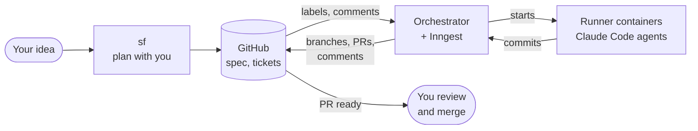

# sf-kit: a self-hosted software factory

sf-kit turns GitHub issues into pull requests. Agents do the work in Docker containers on your own machines. You make the decisions. The factory does the typing.

You start from an idea. The `sf` command plans it with you, writes a spec and tickets, and gives the tickets to the factory. Then it shows the agents at work and stops when something needs you.



## Quick start

```bash
# 1. Prepare the factory host, once. The dry run shows each change first.
./init-host.sh --observability phoenix --dry-run
./init-host.sh --observability phoenix

# 2. Add a factory for each repo.
./setup-wizard.sh

# 3. Put sf on your PATH.
ln -s "$PWD/sf" ~/.local/bin/sf

# 4a. Start a new project.
cd ~/code && sf new my-app "<what you want to build>"

# 4b. Or prepare an existing project. Add --dry-run first to see the changes.
./init-project.sh --path ~/code/my-app --labels
(cd ~/code/my-app && npm i -D @ai-hero/sandcastle@^0.14 tsx zod@^3.25)
cd ~/code/my-app && sf idea "<what you want to build>"
```

Each script prints its next steps at the end. Run the scripts as your own user, not with `sudo`.

## Read next

| Doc | Read it when you want to |
| --- | --- |
| [Set up a factory host](docs/setup.md) | install the host, add repos, add worker machines, use `sf` from a laptop, or open the dashboards |
| [Use `sf`](docs/sf.md) | plan an idea, start the build, read the board, or follow one agent |
| [What the factory runs](docs/factory.md) | know what each label starts and what each task does |
| [Security](docs/security.md) | know what an agent can reach and whose issues it follows |

## What is in this folder

| Path | What it does |
| --- | --- |
| `sf` (`cli/sf.mjs`) | The pipeline CLI. It takes an idea from planning to merged pull requests, and shows the runs and the agents. |
| `init-host.sh` | Prepares the factory host once. It installs Inngest, Postgres, Redis, optional Phoenix, the run network, the firewall rules and the runner image. It starts no factory. |
| `setup-wizard.sh` | Adds or edits one factory. Run it once for each repo. |
| `init-worker.sh` | Makes a machine a worker machine. A worker machine runs agents for a factory host. |
| `init-project.sh` | Makes a project ready for the factory. It never overwrites a file. |
| `orchestrator/` | The Node app. It turns GitHub events into Inngest events, and its functions run the agents in Docker. |
| `host/` | The compose file, the runner Dockerfile, the Caddyfile, the firewall script and the systemd units. |
| `project-template/` | The files that `init-project.sh` copies into a project. |
| `herdr-plugin/` | An optional [herdr](https://herdr.dev) plugin. It opens a pane that follows one agent. |
