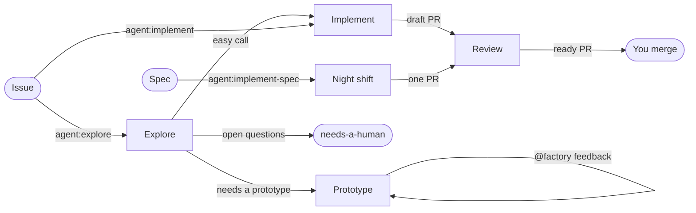
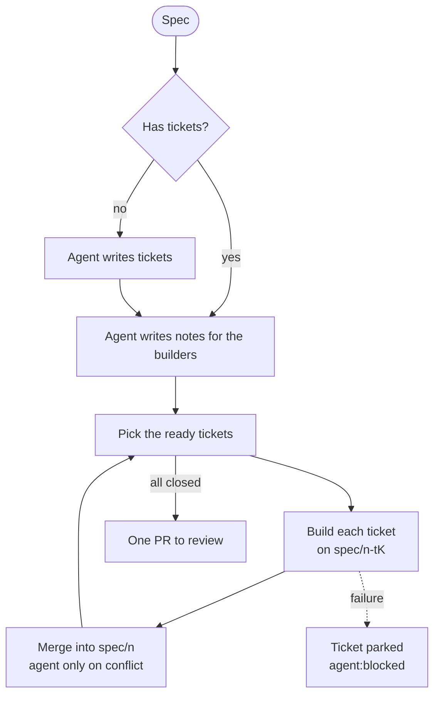

# What the factory runs

Each task is an Inngest function. A label, a comment or a schedule starts it.

| Task | Start | What it does |
| --- | --- | --- |
| Explore | `agent:explore` on issues | Reads the labelled batch and tags each issue. An easy call goes to implement, and a prototype question goes to prototype. All others get `needs-a-human`. It closes duplicates. |
| Implement | `agent:implement` | Builds the ticket, opens a draft PR and gives it to review. |
| Review | `agent:review` on a PR | Reviews the PR against its ticket and the coding standards. Posts the verdict and inline comments, then marks the PR ready. |
| Prototype | `agent:prototype`, or an `@factory` comment on an issue labelled `prototype` | Builds a throwaway prototype on `prototype/issue-<n>` as a draft PR labelled `do-not-merge`. Posts screenshots on the issue. Each `@factory` reply starts the next version. |
| Night shift | `agent:implement-spec` on a spec | Builds the tickets of the spec in parallel and merges each into `spec/<n>`. Then it opens one PR for review. It writes the tickets first if the spec has none. |
| Ratchet | Weekdays at 06:00, or `sf ratchet` | Fixes one lint failure per PR. A script tries first. It stops at 5 open ratchet PRs. |
| Rebase | Nightly, `agent:rebase` on a PR, or `sf rebase` | Rebases PRs on `agent/*` branches, and PRs with the label, when their base moved. A script tries first, and an agent runs only on a conflict. A failure labels the PR `agent:blocked` and opens an issue. |
| Architecture review | Every 2 days, or `sf architecture` | Looks for modules to deepen and files one `architecture` ticket for each strong candidate. It stops at 20 open tickets. It never proposes a candidate twice. |

To start a task by hand, send its event with your factory name, for example `factory/qf/ratchet.requested`. An event name without the factory name starts no run. `sf ratchet`, `sf rebase` and `sf architecture` send the event for the repo of the current folder.

## The night shift

The night shift parks a failed ticket with `agent:blocked`. The other tickets continue. The run stops when no ticket can start.

To continue:

1. Remove `agent:blocked` from the ticket.
2. Add `agent:implement-spec` to the spec again.

## Limits

- The night shift has no review for each ticket. Review reads the whole spec PR. Keep night-shift specs small. The decomposer writes 12 tickets at most.
- The bundled `decompose-prompt.md` names the files and tables of the sample app that it came from. Rewrite it for your project before the night shift writes tickets for you.
- Explore reads at most 100 labelled issues in one run. The rest keep `agent:explore` and wait for the next run.
- `init-project.sh` adds the `prototype-needed` verdict only to explore files that it creates. In an existing copy, add it to the enum in `.sandcastle/agent-workflows/explore/plan-schema.ts` yourself.
- The prototype task posts screenshots and a draft PR. It does not deploy a preview that you can click. To try it, check out the PR and follow `prototypes/issue-<n>/README.md`.
- Review refuses PRs whose head is the base or default branch. It also refuses branch names with characters outside `A-Z a-z 0-9 . _ / -`. It labels these PRs `agent:blocked` with a comment. Rebase skips the same PRs.
- A rebase stops when a workflow file has a conflict. A person resolves it, because the factory never pushes a workflow that an agent wrote.
