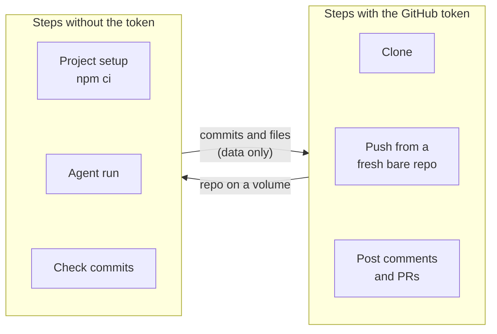

# Security

The factory splits each run into two kinds of steps. Steps with the GitHub token run no project code. Steps that run project code have no token.

## What an agent can reach

- **No agent holds the token.** Every agent runs in a new container with no GitHub token and no Linux capabilities (`--cap-drop ALL`).
- **Agents cannot reach your LAN.** The firewall blocks the private ranges. It also blocks 100.64.0.0/10, the range that Tailscale uses, and 169.254.0.0/16, which holds the metadata address of a cloud machine. `factory-firewall.service` adds the rules again at each boot.
- **Agents share one run network.** An agent of one factory can reach a server that an agent of another factory started. See [Set up a factory host](setup.md#one-factory-per-repo).

## What the token steps do

- **Token steps run no project code.** They never run git inside the repo of the agent. A push copies the commits into a new bare repo and pushes from there. So hooks and config that the agent wrote do not run.
- **Agent files are data.** A token step reads a file of the agent only if it is a plain file under `/tmp`. It refuses symlinks.
- **Workflows stay with people.** The factory refuses to push commits that change `.github/workflows` or `.github/actions`. A pushed workflow runs with the Actions secrets of the repo. The push step checks this against branches that it reads from GitHub, not against the repo of the agent.
- **One exception for workflows.** A rebase keeps the workflow changes of a PR when git merges them with no conflict. The factory refuses a fix by an agent of a conflict in a workflow file.
- **The agent cannot approve.** Review posts inline comments as a plain comment review, never as an approval.
- **The orchestrator checks input.** It checks branch names and issue numbers before they reach a shell. Review and rebase refuse PRs from forks. `sf` lists only PRs from the branches of the repo itself, because it offers to merge them.

## Whose issues an agent follows

Agents follow an issue that an owner, member or collaborator wrote.

They also follow the issue of a stranger after a collaborator labels it. The stranger must not change the title or the body after that first label. A later edit by a collaborator vouches for the text.

The factory checks this after it reads the issue. The check covers tickets, specs, parent specs and explore issues:

- A refused ticket or spec stops the run.
- The factory leaves out a refused parent spec.
- Review continues without a refused spec.
- Comments count only from collaborators. This includes an `@factory` comment on a prototype.

On a public repo, you can also use the interaction limits of GitHub, so only collaborators can open issues and PRs. The checks above still apply without a limit.

The issue check calls two GitHub APIs that are not tested here: the collaborator permission endpoint, and the GraphQL `lastEditedAt` and `editor` fields. If a call fails, the factory refuses the issue of the stranger. The issue of a collaborator needs neither call.

## Traces

With `--observability phoenix`, Phoenix runs with auth on. Without auth, any container on the run network can read the traces of every run. The Phoenix variable names are not tested here.
