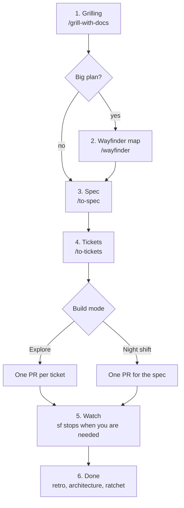

# Use `sf`

`sf` takes an idea from planning to merged pull requests. It suggests each step and runs it only when you say yes. Run `sf` again at any time to continue where you stopped.

## The pipeline



| Step | Who works | What happens |
| --- | --- | --- |
| 1. Grilling | You and Claude | `/grill-with-docs` asks you questions until the plan is clear. It writes `GLOSSARY.md` and ADRs. It tells you if the plan needs a Wayfinder map. You decide. |
| 2. Wayfinder (optional) | You and Claude | `/wayfinder` makes a map of decision tickets. `sf` opens a new session for each ready ticket until the map is clear. |
| 3. Spec | You and Claude | `/to-spec` publishes the spec issue with the label `spec`. |
| 4. Tickets | You and Claude | `/to-tickets` publishes sub-issues of the spec with blocking edges. You approve the split. |
| 5. Build | The factory | `sf` checks that you committed `GLOSSARY.md`, `CODING_STANDARDS.md` and `docs/`, and that they are on GitHub. The agents clone from there. `sf` pulls before it pushes, and it stops on a conflict. Then it starts the build mode that you picked. |
| 6. Done | You and Claude | `sf` offers to close the spec. It suggests `/retro`, an architecture review and a lint ratchet run. Each one asks first. |

There are two build modes:

- **Explore** labels each ready ticket `agent:explore`. Each ticket gets its own PR.
- **Night shift** labels the spec `agent:implement-spec`. You get one PR for the whole spec.

[What the factory runs](factory.md) explains both.

### The docs change with the code

Each ticket that the agents get ends with its parent spec. So the decisions of the spec reach the implementer and the reviewer. The implementer adds each new domain term to `GLOSSARY.md` in its PR. The reviewer adds each judgement rule that it wanted to `CODING_STANDARDS.md` on the PR branch. You approve both when you merge.

### Fewer questions

Add `--recommended` (or `-r`) to `sf idea` or `sf new` to answer fewer questions. The grilling then takes its own recommended answer for each question. It asks you only for facts that it cannot know, and for hard-to-reverse choices with no clear answer. At the end, it lists each decision that it made, so you can overrule any of them. `sf` also takes the Wayfinder suggestion of the session.

### Issues from outside the spec

`sf` also shows open issues from outside its spec that carry a factory label. When no idea is in progress, run `sf` to see only these issues.

`ready-for-agent` marks an issue as ready, but it starts no run. `sf` offers each such issue to the factory and adds `agent:explore` when you say yes. Explore follows the rule in [Security](security.md). It removes the label from an issue that fails the rule and says why in a comment.

### When `sf` stops

While the factory builds, `sf` shows the status of each ticket, the runs of the factory and the actions of the agents. It stops when:

- a PR is ready to merge
- a ticket needs your decision
- a prototype is ready to see
- a run failed

### Rules that `sf` keeps

- **Planning sessions are interactive.** Type `/exit` in Claude to go back to `sf`. Each session writes a small result file in `.sf/`, for example the spec number. If the file is missing, `sf` asks you.
- **GitHub holds the state.** `.sf/state.json` holds only the Claude session id and the spec and map numbers. Git ignores it.
- **`sf` never merges on its own.** A merge needs two yes answers. The default answer at every stop is "skip".
- **`sf` needs a terminal.** Without one, it reads one answer per line from stdin and stops when the answers run out. It never answers for you.
- **One open factory PR per ticket.** An implement run does not start when the ticket has an open `agent/issue-<n>-...` PR. It removes `agent:implement` and says so in a comment. Close the PR to build again. `sf` also reads the labels again before a retry, so an old retry prompt does not start a second run.
- `sf` reads blocking edges from the `## Blocked by` section of each ticket, and from the GitHub dependency API every 5 minutes.

## Commands

| Command | What it does |
| --- | --- |
| `sf idea "<idea>"` | Plans an idea in the current project. |
| `sf new <name> "<idea>"` | Makes a new project, then plans the idea. |
| `sf` | Continues where you stopped. |
| `sf status` | Prints the board once. |
| `sf watch` | Prints the board every 10 seconds. |
| `sf logs <text>` | Follows the log of one agent. |
| `sf retro` | Starts a retro of the recent planning sessions. |
| `sf architecture`, `sf ratchet`, `sf rebase` | Start one run of that factory task now. |

## What the board shows

Below the tickets, the board shows two blocks.

**Runs.** This block lists the Inngest runs of the factory that are running or queued, at most 10. It leaves out `github-poll`. A run in prepare, setup, push or a wait for a slot has no agent container, so only this block shows it. Each row has these parts:

- the function name, and `#<n>` or `PR #<n>` when the event of the run names an issue or a PR
- the step: `last step <name> ended <time> ago`, else `queued` or `starting`
- `run <time>`: the time since the run started

On 2026-11-13, the trace of a running run on this host listed only finished steps. So the row names the last finished step, not the step that runs now. When Inngest does not answer in 2 seconds, or has no app for the factory, the block is one dim line. The board does not stop.

**Agents.** This block lists each agent container of the repo on this machine. The first row has the subject, the age and a `sf logs '<subject>'` command that you can paste into a shell. The rows below it come from a hook in the agent container:

- `now <tool> <input> · <time>`: the tool call that runs now
- up to 3 `done` or `fail` rows, newest first, with the duration of each call, or `denied`
- `finishing: the agent stopped`, after the `Stop` event of the agent

`sf` reads the agent containers through Docker on the same machine, so it needs Docker access. It shows only the agents of its repo. For agents on another machine, use the Inngest dashboard.

The orchestrator writes the hook into `$HOME/.claude/settings.json` before the agent starts. The hook writes one JSON line for each tool call to the container log. Only agents that the current orchestrator code started have the hook. For an older container, the block shows its last 4 log lines.

### Limits of the board

- The agent block reads the last 200 lines of each agent log. A run with much Sandcastle output between the activity lines shows fewer finished calls.
- The first 80 characters of each tool input are in the `docker logs` of the agent. Anyone with Docker access on the host can read them.
- A call that a permission dialog denies, or that a `PreToolUse` hook blocks, sends no event to the hook. Source: the [hooks docs](https://code.claude.com/docs/en/hooks), read on 2026-11-13. The call stays `now` until the agent stops.
- If the image or a start script puts a `$HOME/.claude/settings.json` in the agent container, the orchestrator keeps it. That agent then runs without the hook and prints `sf: ... exists, no activity hook` to its log.
- The runs block never showed a step that runs now. The code has a row for one, but that row depends on a trace shape that nobody saw. The block reads runs queued in the last 7 days.

## Follow one agent

`sf logs <text>` follows the log of one agent.

- An exact subject wins.
- Part of a subject works when only one agent matches. When several agents match, `sf` lists them and stops.
- `sf logs --container <container name>` follows one agent container by name. It works from any folder.

Activity lines show as one readable line each, with the time. When Sandcastle prints its own block for a Bash call, `sf` shows only the activity line for that call. `sf` prints the other log lines too, with escape and control characters removed.

## The herdr plugin

If you work in [herdr](https://herdr.dev), the plugin in `herdr-plugin/` gives you a picker of the running agents. Link it once:

```bash
herdr plugin link <path to sf-kit>/herdr-plugin
```

When herdr is on the `PATH` and the plugin is not linked, the board prints this command with the path filled in. `sf` never links the plugin itself.

The plugin has one action, "Watch a factory agent" (`watch-agent`). It opens a popup with the running factory agents of all repos on this machine: subject, repo and age. Pick one, and a new tab pane runs `sf logs --container <container name>`. That command works from any folder, so the plugin needs no project folder. The plugin needs `fzf` and `node`.
